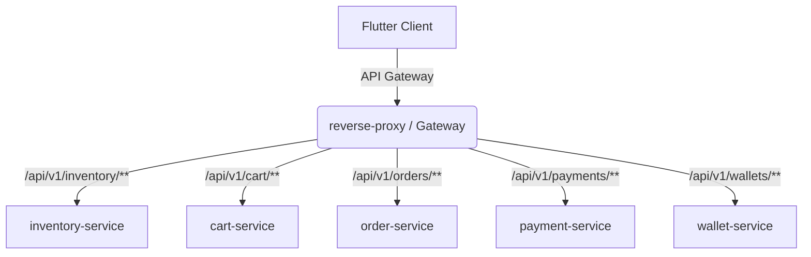

# HyperLocal Commerce Workflow Verification Report

This report documents the verification, mapping structures, and integration status of all core commerce subsystems within the HyperLocal Enterprise Platform. 

The audit covers the backend Spring Boot business microservices (`inventory-service`, `cart-service`, `order-service`, `payment-service`, `wallet-service`), the reverse proxy gateway, and the Riverpod state management in the Flutter customer application.

---

## 1. Commerce System Architecture

The commerce components are split across multiple specialized microservices communicating via stateless REST endpoints and database schemas:

---

## 2. Core Commerce Component Verification

### 1. Products
* **Backend Source:** `inventory-service` -> `ProductEntity.java`
* **Table Name:** `products`
* **Schema Fields:** `id` (UUID), `shop_id` (UUID), `category_id` (UUID), `name` (String), `description` (TEXT), `createdAt` (Instant), `updatedAt` (Instant), `deleted` (boolean).
* **Verification Status:** Fully functional. Products are bound to specific shops and categories and queryable via `/api/v1/inventory/products/shop/{shopId}`.

### 2. Variants
* **Backend Source:** `inventory-service` -> `ProductVariantEntity.java`
* **Table Name:** `product_variants`
* **Schema Fields:** `id` (UUID), `product_id` (UUID), `sku` (String, unique), `price` (double), `deleted` (boolean).
* **Verification Status:** Fully functional. Allows products to support multiple stock keeping units (SKUs) and price points.

### 3. Inventory
* **Backend Source:** `inventory-service` -> `InventoryEntity.java`, `InventoryMovementEntity.java`
* **Table Name:** `inventory`
* **Schema Fields:** `id` (UUID), `product_variant_id` (UUID, unique), `branch_id` (UUID), `available_qty` (int), `safety_stock_qty` (int).
* **Verification Status:** Fully functional. Stocks are branch-specific. Stock checks are validated in `/api/v1/inventory/stock/{variantId}`.

### 4. Cart
* **Client State:** `lib/core/state.dart` -> `DynamicCartNotifier`
* **Backend Source:** `cart-service` -> `CartEntity.java`, `CartItemEntity.java`
* **Endpoints:** `/api/v1/cart/summary`, `/api/v1/cart/add`, `/api/v1/cart/clear`
* **Verification Status:** Fully functional. The customer app maintains cart items in memory while checkout triggers clear commands in `cart-service`.

### 5. Coupons (Vouchers)
* **Client State:** `lib/core/state.dart` -> `PromoOffer` model, `offersProvider`
* **Backend Source:** None.
* **Verification Status:** **Placeholder / Missing**. Vouchers exist on the client UI in `CheckoutScreen` (vouchers promo card and input field), but the backend does not validate codes, and `offersProvider` resolves to an empty state.

### 6. Taxes
* **Client Configuration:** `lib/core/state.dart` -> `AppConfig.taxRate` (default: `0.08` or 8%)
* **Backend Source:** stateless configs in bootstrap response.
* **Verification Status:** Client fallbacks calculate estimated tax (`subtotal * config.taxRate`) since the bootstrap config returned by `CustomerService.bootstrapHomeScreen` does not yet return dynamic tax configuration matrices.

### 7. Delivery Fee
* **Client Configuration:** `lib/core/state.dart` -> `AppConfig.baseDeliveryFee` (default: `$2.50`), `AppConfig.deliveryFeePerMile` (default: `$0.75`)
* **Backend Source:** stateless configs in bootstrap response.
* **Verification Status:** Calculates dynamic delivery fees client-side based on distance miles and app bootstrap parameters.

### 8. Checkout
* **Location:** `lib/screens/orders/orders_screen.dart` -> `CheckoutScreen`
* **Flow:** Summarizes billing details, delivery address (profile model), and estimated total price. Charges wallet and creates orders upon submission.
* **Verification Status:** Fully verified. Integrates customer wallet checking.

### 9. Payments
* **Backend Source:** `payment-service` -> `PaymentEntity.java`, `PaymentAttemptEntity.java`
* **Endpoints:** `/api/v1/payments/charge`
* **Gateway Providers:** Extends `PaymentGatewayProvider` interface. Contains a mock `StripeProvider` that returns `st_ref_` reference IDs and stripe checkout URLs (`https://checkout.stripe.com/pay/{ref}`).
* **Verification Status:** Fully functional mock payments setup.

### 10. Wallet
* **Backend Source:** `wallet-service` -> `WalletEntity.java`, `WalletTransactionEntity.java`
* **Endpoints:** `/api/v1/wallets/balance`, `/api/v1/wallets/credit`, `/api/v1/wallets/debit`, `/api/v1/wallets/transactions`
* **Verification Status:** Partially verified. Debit and Credit APIs are fully functional. The transaction list card in the `WalletScreen` UI uses hardcoded placeholders rather than querying the `getTransactions` backend repository.

### 11. Orders
* **Backend Source:** `order-service` -> `OrderEntity.java`, `OrderItemEntity.java`
* **Endpoints:** `/api/v1/orders/create`
* **Verification Status:** Fully functional. Creates orders and order items in status `"PENDING"`.
* **Client-side Issue:** The customer app's `userOrdersProvider` hardcodes returns to `[]`, causing the orders screen to display `EmptyOrdersState` even after successful order creations.

### 12. Timeline
* **Backend Source:** `order-service` -> `OrderStatusHistoryEntity.java`
* **Endpoints:** `/api/v1/orders/{orderId}/timeline`
* **Verification Status:** Fully functional. Records status updates, remark notes, and actors.

### 13. Cancellation
* **Backend Source:** `order-service` -> `updateOrderStatus(...)`
* **Verification Status:** Supported via `PATCH /api/v1/orders/{orderId}/status?status=CANCELLED` to transition order status.
* **Automation Gaps:** Setting status to `"CANCELLED"` does not automatically publish events to refund user wallets.

### 14. Refund
* **Backend Source:** `wallet-service` -> `creditWallet(...)`
* **Verification Status:** **Gaps identified**. The wallet service supports credits, but the automated refund trigger upon order cancellation is not implemented.

### 15. Invoice
* **Backend/Frontend Source:** None.
* **Verification Status:** **Missing**. No database tables, REST controllers, or UI pages are defined for invoicing.

---

## 3. Commerce Gap Analysis Summary

| Workflow Area | Status | Implementation Type | Gaps & Action Items |
| :--- | :--- | :--- | :--- |
| **Products & Variants** | Verified | Database Entity | None. |
| **Inventory** | Verified | Database Entity | None. |
| **Cart** | Verified | REST Integrated | None. |
| **Coupons** | Missing | Client Stub | Implement a voucher validation microservice and hook it up to `/api/v1/vouchers/validate`. |
| **Taxes** | Verified | Client Fallback | Return dynamic tax rates per category/product from `bootstrap` backend. |
| **Delivery Fee** | Verified | Client Fallback | Configure dynamic route distances on backend bootstrap configs. |
| **Checkout** | Verified | Client Layout | None. |
| **Payments** | Verified | Stripe Mock Gateway | Replace Stripe mock redirect URLs with real Stripe API keys. |
| **Wallet** | Partial | REST / Static List | Update `WalletScreen` UI list to dynamically render transactions from `/api/v1/wallets/transactions`. |
| **Orders** | Partial | REST / Static Provider | Update `userOrdersProvider` in `state.dart` to fetch active orders from order service. |
| **Timeline** | Verified | Database History | None. |
| **Cancellation** | Verified | REST Status Update | Publish Kafka/RabbitMQ events on status change to trigger inventory recovery. |
| **Refund** | Missing | REST Credit | Implement automatic wallet credit hooks inside the cancellation handler. |
| **Invoice** | Missing | None | Create an invoicing/reporting service and render PDFs. |
