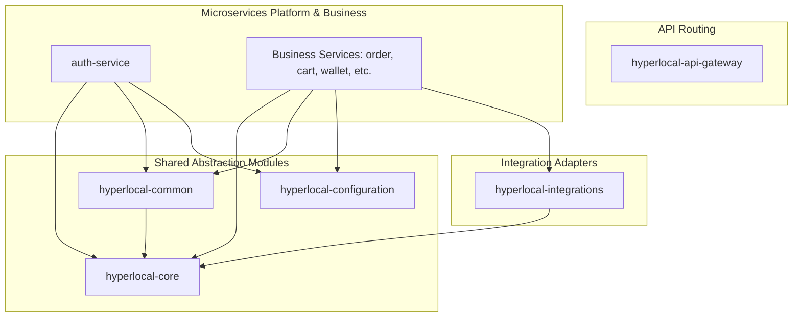
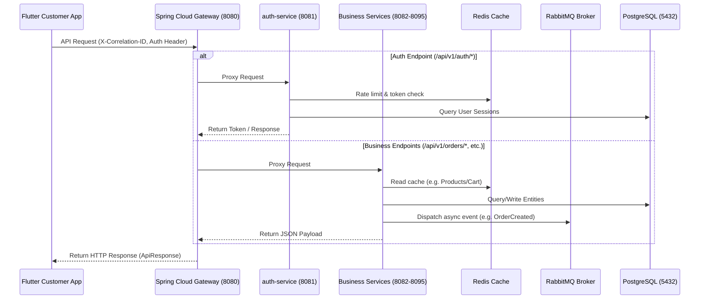

# Dependency Graph — HyperLocal Enterprise Platform

This document describes the compilation dependencies and runtime communications linkages across the platform modules.

---

## 1. Compile-Time Dependency Flow (Maven)

---

## 2. Runtime Flow (Traffic & Data)

---

## 3. Flutter Client Package Dependencies

- **`flutter_riverpod`**: State management and dependency injection container.
- **`dio`**: Http client library with retry capabilities, correlation header injections, and token refreshing interceptor.
- **`flutter_map` (OpenStreetMap)**: Dynamic map tile rendering engine using cached files.
- **`geolocator`**: Runtime geolocation provider supporting accuracy levels and mock GPS telemetry detection.
- **`permission_handler`**: Checks location settings status.
