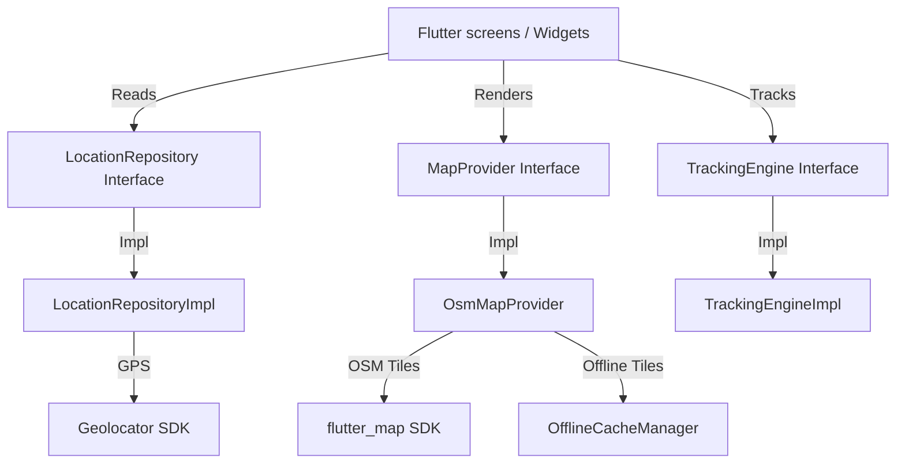
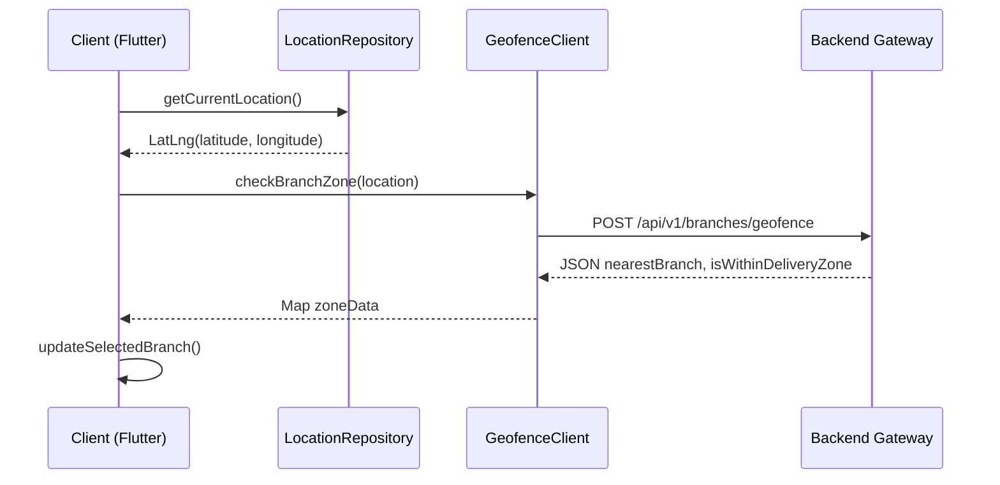

# Location Intelligence Platform (LIP) Technical Specification & Architecture

This document maps out the design, caching mechanisms, tracking routines, security metrics, and future migration protocols of the production-grade Location Intelligence Platform (LIP) built inside the HyperLocal Enterprise Client.

---

## 1. System Architecture

LIP decouples all client widgets and features from mapping SDKs and hardware geolocation dependencies. Interfaces handle all operations to enable pluggable providers:



---

## 2. Directory Structure

The platform is isolated as a reusable package inside `lib/lip`:

```
lib/lip/
├── domain/                      # Clean Architecture abstractions
│   ├── map_provider.dart        # Interface: MapProvider, MarkerType, MapMarker
│   ├── route_provider.dart      # Interface: RouteProvider, MapRoute
│   ├── geocoding_provider.dart  # Interface: GeocodingProvider
│   ├── location_repo.dart       # Interface: LocationRepository
│   ├── permission_state.dart    # Enum: LipPermissionState
│   ├── tracking_engine.dart     # Interface: TrackingEngine
│   ├── eta_engine.dart          # Interface: EtaEngine
│   ├── geofence_client.dart     # Interface: GeofenceClient
│   └── cache_manager.dart       # Interface: OfflineCacheManager
├── infrastructure/              # Concrete implementations & packages
│   ├── providers/
│   │   ├── osm/                 # OpenStreetMap integrations
│   │   │   ├── osm_map_provider.dart
│   │   │   ├── osrm_route_provider.dart
│   │   │   ├── openroute_route_provider.dart
│   │   │   └── nominatim_geocoding_provider.dart
│   │   ├── google/              # Google Maps stubs (future-ready)
│   │   ├── mapbox/              # Mapbox stubs (future-ready)
│   │   └── here/                # HERE Maps stubs (future-ready)
│   ├── location_repo_impl.dart  # Geolocator integrations
│   ├── permission_manager.dart  # Permission handler state machine
│   ├── tracking_engine_impl.dart# Background location streams
│   ├── eta_engine_impl.dart     # Routing travel time calculations
│   ├── geofence_client_impl.dart# PostGIS backend zone geofencing
│   ├── marker_service.dart      # Dynamic caching & grid-based clustering
│   └── offline_cache_manager.dart# Local file LRU storage caches
├── lip_config.dart              # Environment parameters loader
└── lip_di.dart                  # Riverpod Dependency Injection registration
```

---

## 3. Data Flow & Sequence Diagram

### 1. Dynamic Geofencing & Branch Detection
When a user launches the app or triggers location updates:
1. `PermissionScreen` requests fine location permission.
2. `LocationRepository` obtains current coordinates.
3. Coordinates are sent to `GeofenceClient`.
4. `GeofenceClient` posts JSON to backend proxy (`/api/v1/branches/geofence`).
5. Backend (PostGIS coordinates checks) resolves the nearest branch and returns zone validation:



### 2. Live Tracking & Route Updates
During order deliveries:
1. `TrackingScreen` queries `LiveTrackingNotifier` updates.
2. When rider coordinates update, `RouteProvider` (OSRM/ORS) recalculates route polylines.
3. `EtaEngine` updates arrival predictions.
4. Renders update onto `MapProvider` using tile cache layers.

---

## 4. Offline & Caching Strategies

To ensure resilience in network-denied states, LIP runs a layered local filesystem cache using the `OfflineCacheManager`:
* **Tile Cache:** Integrates a custom `CachedTileProvider` which downloads and saves PNG tiles to local directory `/lip_cache`. It intercepts downloads and serves local cached files if available.
* **Route Cache:** Caches routing JSON coordinate chains, bypassing repeat calls to OSRM.
* **Address Cache:** Nominatim geocoder lookups cache reverse geocodes to prevent hitting rate-limiting.
* **LRU Eviction:** If cache directory entries exceed 500 files, the manager automatically evicts the oldest 100 files using modified-time sorting.

---

## 5. Security & Spoofing Detection

To ensure enterprise location integrity, the `LocationRepositoryImpl` includes spoof detection checks:
1. **Mock GPS Detection:** Evaluates Android's developer-option mock providers using Geolocator's `isMocked` property.
2. **Coordinate Sanity Checks:** Discards zero values, coordinates with impossible altitudes, or repeat coordinates indicating static mock emulation.
3. **Telemetry Logs:** Triggers mock notifications and sends security events to the audit backend.

---

## 6. Future Migration Guide to Google Maps

If migrating to Google Maps SDK or Google Directions API:
1. Add `google_maps_flutter` package to `pubspec.yaml`.
2. Write a new `GoogleMapProvider` class under `lib/lip/infrastructure/providers/google/` that implements `MapProvider`.
3. Implement `GoogleRouteProvider` using Directions API.
4. Implement `GoogleGeocodingProvider` using Google Places/Geocoding API.
5. In `lib/lip/lip_di.dart`, update the `mapProvider` conditional mapping:
   ```dart
   final mapProvider = Provider<MapProvider>((ref) {
     final cfg = ref.watch(lipConfigProvider);
     if (cfg.activeMapProvider == 'google') {
       return GoogleMapProvider(ref); // Instantiate Google Maps provider
     }
     return OsmMapProvider(ref);
   });
   ```
6. No changes are required in any UI pages or repository states, maintaining strict separation of concerns.
