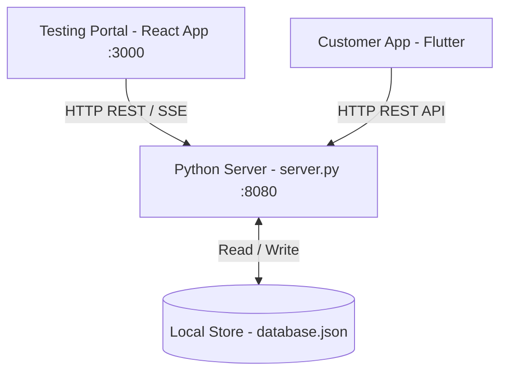

# HyperLocal Testing Portal — Architecture Specification

This document details the architectural layout, technology stack, data flow, and runtime environment of the HyperLocal Testing & Simulation Portal.

---

## 1. System Overview

The **HyperLocal Testing Portal** is a standalone, web-based control center built specifically for developers, QA engineers, and testers. It acts as an orchestrator of simulated events (e.g. branch creation, shop configuration, product additions, stock status adjustments, order flow progression, GPS coordinates movement, wallet adjustments, and payment result injection).

Every operation performed in the testing portal modifies the active state on the Python mock server (`server.py`), which persists state directly to the local JSON store (`database.json`). The Customer Flutter app, configured to poll or sync with the mock backend, displays these updates dynamically.

---

## 2. Technology Stack

### Frontend Application
- **Core Framework**: React 18 + Vite (for high-speed HMR and optimized bundler mode)
- **Programming Language**: TypeScript (with relaxed type assertions where needed for simulation interfaces)
- **UI Design System**: Material UI v5 / v6 (Dark premium theme utilizing indigo, cyan, success, warning, and error colors)
- **State Management & Fetching**: React Query (TanStack Query) v5 for optimistic updates, caching, and polling orchestration
- **Real-Time Client**: EventSource API for Server-Sent Events (SSE) log monitoring
- **Mapping & Location Simulator**: Leaflet.js with OpenStreetMap (OSM) tile rendering

### Backend Mock Extensions
- **Server Module**: Extended Python standard `http.server.BaseHTTPRequestHandler`
- **Concurrency**: Refactored to multi-threaded execution using `socketserver.ThreadingMixIn` to handle concurrent SSE connections and REST API queries without deadlocks
- **Data Persistence**: `database.json` read/write synchronization
- **Event Bus**: In-memory pub/sub queue that broadcasts events to all active SSE subscribers upon write operations

---

## 3. Communication Protocols

1. **REST APIs (JSON over HTTP)**: Used for all transactional commands (e.g., product creation, wallet credit/debit).
2. **Server-Sent Events (SSE)**: Used by the **Live Event Monitor** to maintain a persistent one-way connection to `/api/portal/events`, streaming logs of all operations in real-time.
3. **CORS Configuration**: The Python backend is configured to accept CORS preflight requests (`OPTIONS`) and allows requests from `http://localhost:3000` with headers `Content-Type`, `X-User-ID`, `X-Session-ID`, and `Authorization`.

---

## 4. Security & Isolation

- **Isolation**: The portal does not touch live production customer databases or real Auth0/Google sign-in services. It operates entirely on the local simulated sandbox.
- **Developer Access**: Designed as a developer-only dashboard. The portal is configured with a bypass banner indicating it is active in developer simulation mode.
